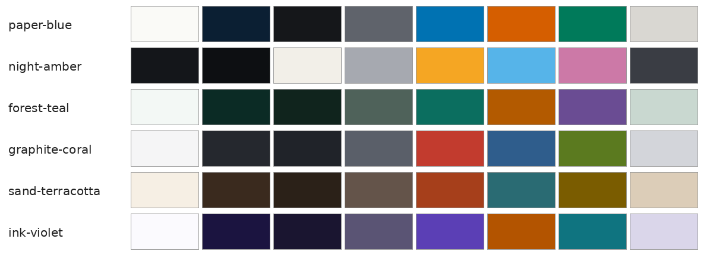

# MGE-SciSlides

[Read in English](README.md)

Um kit pequeno e autônomo em Python para fazer **apresentações científicas e acadêmicas**
(`.pptx`) com [python-pptx](https://python-pptx.readthedocs.io): decks 16:9 com temas,
layouts prontos, animações por clique, verificador de deck, ferramentas de mídia (montagem de
vídeo, figuras de moléculas, perfis de energia) e o ciclo "renderizar e olhar".

Nasceu de uma palestra real para calouros e guarda as lições: uma ideia por slide, letra
grande, linha de progresso, revelações clique a clique e sempre renderizar o deck para *olhar*.



## Recursos

| Área | O que você ganha |
|---|---|
| `scislides.theme` | 6 temas pensados para daltônicos (claros e escuros), verificador de contraste WCAG, tema próprio via JSON/YAML |
| `scislides.deck` | `Deck`: sobretítulo + título-afirmação, número de página, texto com tamanhos mínimos garantidos, imagem ajustada/cortada, sangria total, notas do orador, grupos, linha de progresso ("carrier"), animações de clique (aparecer/esmaecer/pulso) e transições fade/morph (XML próprio, sem dependência externa) |
| `scislides.layouts` | título, divisória de seção, tópicos + figura, linha do tempo, abertura com imagem em sangria, nomes revelados um por clique, camadas de figura reveladas por clique, encerramento |
| `scislides.edit` | editar decks existentes: achar forma, trocar texto, remover, reordenar, renumerar, trocar imagem/GIF no lugar, limpar animações órfãs |
| `scislides.check` | verificador: tamanhos mínimos de fonte, formas fora do slide, estimativa de estouro de texto, imagens sem texto alternativo, limite de tamanho do arquivo, caracteres proibidos |
| `scislides.render` | pptx para PDF (LibreOffice) para PNG (pdftoppm) para folha de contato |
| `scislides.media.video` | busca, download, folhas de contato, detecção de clarão, cortes de cena, legendas (yt-dlp + ffmpeg) |
| `scislides.media.montage` | MP4 com som e GIF com paleta a partir de uma especificação YAML/JSON: corte, câmera lenta, rótulos, cartela final |
| `scislides.media.molecules` | fórmulas 2D com RDKit; GIFs 3D giratórios a partir de XYZ/SMILES (3Dmol.js + Chromium headless) |
| `scislides.media.plots` | perfil de energia exportado em camadas transparentes para revelar por clique, amostras de tema |

## Instalação

```bash
python -m venv .venv && source .venv/bin/activate
pip install -e .              # núcleo: python-pptx, lxml, Pillow, numpy, matplotlib
pip install -e '.[molecules]' # opcional: rdkit, playwright  (depois: playwright install chromium)
pip install -e '.[video]'     # opcional: yt-dlp, pyyaml
```

Programas externos (opcionais, só para os recursos que os usam): `soffice` (LibreOffice) e
`pdftoppm` (poppler) para renderizar; `ffmpeg` para vídeo (ou defina `FFMPEG=/caminho/ffmpeg`).

## Início rápido

```python
from scislides import Deck, layouts

d = Deck("night-amber", title="Minha palestra", author="A. Pesquisadora", lang="pt-BR")
layouts.title_slide(d, "Por que as moléculas vibram", "Uma introdução curta", "A. Pesquisadora")
s = layouts.timeline(d, "História", "Três ideias, três décadas",
                     [("1990", "Ideia um", "O que mudou"), ("2005", "Ideia dois", "Por que importou")])
d.notes(s, "Diga as datas por último, não primeiro.")
d.save("out/palestra.pptx")
```

Ou rode a demonstração completa com qualquer tema:

```bash
python examples/demo_deck.py --list-themes
python examples/demo_deck.py --theme forest-teal -o out/demo.pptx
scislides-check out/demo.pptx
scislides-render out/demo.pptx -o out/render     # PDF, PNGs e contact.png
```

## Ferramentas de linha de comando

| Comando | Para quê |
|---|---|
| `scislides-check deck.pptx [--forbid "—"]` | verifica um deck; código de saída 1 se houver erros |
| `scislides-render deck.pptx -o pasta` | renderiza em PDF/PNG e folha de contato |
| `scislides-video search\|download\|sheet\|flash\|cuts\|subs` | apoio à pesquisa de vídeos |
| `scislides-montage spec.yaml` | monta vídeo legendado e GIF |
| `scislides-mol 2d SMILES saida.png` / `scislides-mol gif SMILES_ou_XYZ saida.gif` | figuras de moléculas |

## Documentação

- [docs/GUIDE.pt-BR.md](docs/GUIDE.pt-BR.md): regras de design que fazem a palestra funcionar
  (inglês: [docs/GUIDE.md](docs/GUIDE.md))
- [docs/THEMES.md](docs/THEMES.md): temas, prévias e como criar o seu (em inglês)
- [docs/MEDIA.md](docs/MEDIA.md): vídeos, montagem, tamanho de GIF, proveniência, ética, ilustração por IA (em inglês)
- [docs/MOLECULES.md](docs/MOLECULES.md): figuras de moléculas 2D e 3D (em inglês)

## Projetos relacionados

- **[mpl-animation](https://github.com/hugogontijomachado/mpl-animation)**, de
  [@hugogontijomachado](https://github.com/hugogontijomachado): clipes explicativos animados com
  matplotlib, feitos de etapas que terminam cada uma numa pausa. Gera MP4/GIF, corta os clipes nas
  pausas e pode montar um PowerPoint em que cada clique toca o clipe seguinte. Use quando o gráfico
  precisa se *mover* no palco. Combina com `scislides.media.plots` (camadas estáticas) e com as
  ferramentas de GIF daqui.
- **[MGE-MolecularMotionVideo](https://github.com/MrGoulart3/MGE-MolecularMotionVideo)**: uma skill
  para vídeos narrados e cientificamente corretos de movimento molecular. Usa o Blender com
  geometria real e movimento vindo de cálculos (MD, IRC/NEB, modos normais), além de narração por
  voz sintética e legendas. Use quando um GIF não basta e o slide pede um filme curto.

## Testes

```bash
pip install -e '.[test]' && pytest
```

Os testes que dependem de peças opcionais (RDKit, ffmpeg) são pulados quando elas faltam.

## Licença

MIT. Veja [LICENSE](LICENSE). Vídeos, imagens e fontes que você usar continuam sob suas próprias licenças.
