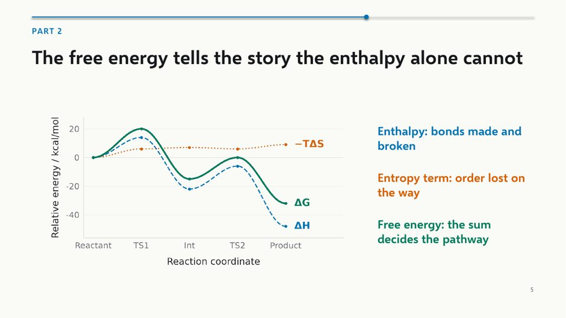
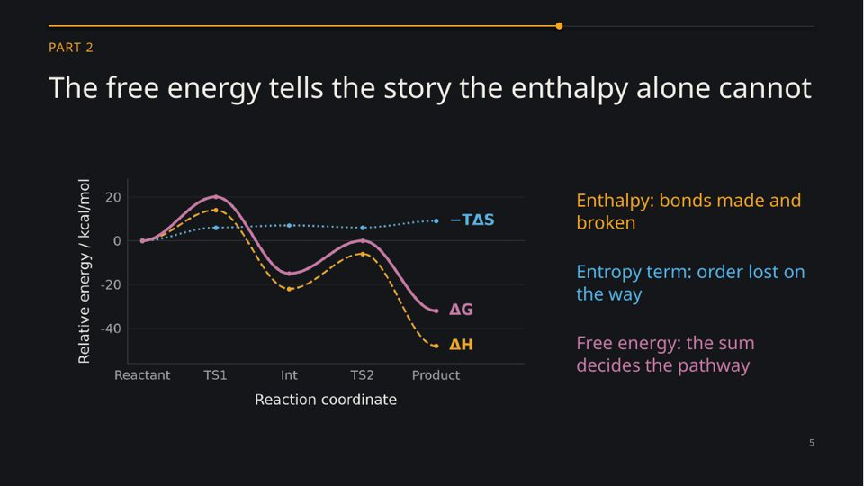
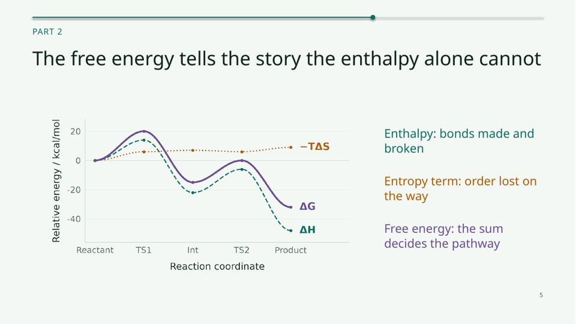
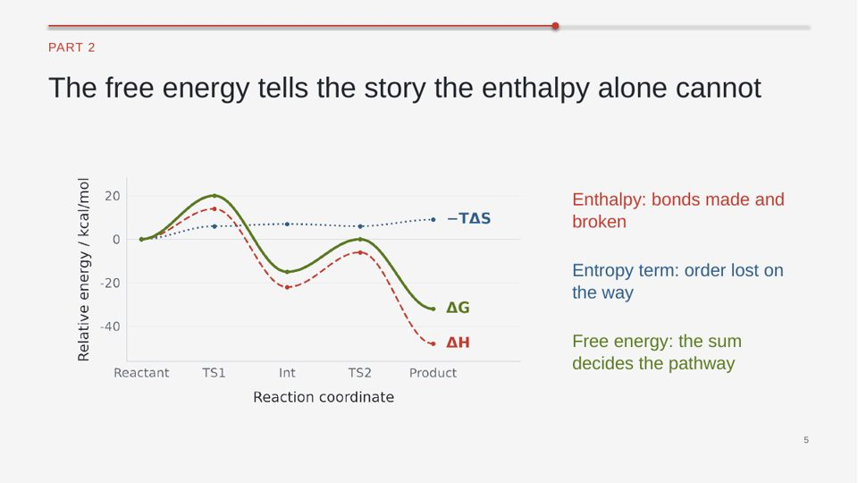
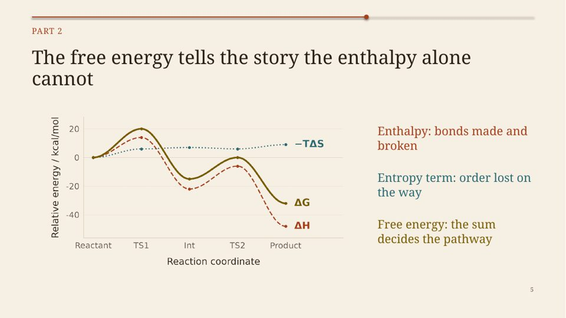
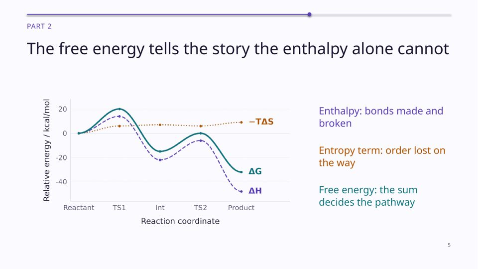

# Themes

[README](../README.md) | [README em português](../README.pt-BR.md)

A `Theme` is a frozen dataclass: background, ink, muted, rule, three accents, a dark
background for opener/closing slides (plus a lighter accent for it), three font names and the
minimum font sizes. All presets pass `Theme.check()`: ink 7:1, muted and primary accent 4.5:1,
other accents 3:1 against the background; the dark variant likewise.


Columns in the swatch: background, dark background, ink, muted, rule, accent, accent 2, accent 3.

| Preset | Mood | Use it when | Preview |
|---|---|---|---|
| `paper-blue` | calm, neutral, classic Okabe-Ito blue/orange/green | default; seminars, lectures, anything projected in a lit room |  |
| `night-amber` | dark, warm, cinematic | dim auditoriums, evening talks, video-heavy decks |  |
| `forest-teal` | fresh, natural | environment, biology, green chemistry |  |
| `graphite-coral` | modern, technical, high energy | engineering, data, lab-meeting updates |  |
| `sand-terracotta` | warm, humanistic, serif | history of science, outreach, teaching |  |
| `ink-violet` | focused, academic | theory, computation, defenses |  |

Opener slides in the same themes: see `img/*-opener.jpg`.

Use one by name: `Deck("ink-violet")`, `python examples/demo_deck.py --theme ink-violet`.

## Make your own

```python
from dataclasses import replace
from scislides import Deck, PRESETS

mine = replace(PRESETS["paper-blue"], name="my-lab", accent="8A2BE2", accent_on_dark="C9A0FF",
               font_title="Source Sans Pro Semibold", font_body="Source Sans Pro")
assert mine.check() == [], mine.check()     # contrast problems are listed here
d = Deck(mine)
```

Or write a JSON/YAML file with the same field names (missing ones use the defaults) and pass
its path: `Deck("my_theme.yaml")`, `--theme my_theme.yaml`.

```yaml
name: my-lab
background: "FFFFFF"
ink: "111111"
muted: "595959"
rule: "DDDDDD"
accent: "8A2BE2"
accent2: "D55E00"
accent3: "007A5A"
dark_bg: "1A0F2E"
accent_on_dark: "C9A0FF"
font_title: "Source Sans Pro Semibold"
font_body: "Source Sans Pro"
font_light: "Source Sans Pro Light"
```

Tips: pick fonts installed on the presentation machine (or embed by exporting a PDF backup);
for color-vision safety keep accents apart in lightness as well as hue; test with a grayscale
print of the contact sheet.
